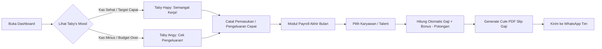
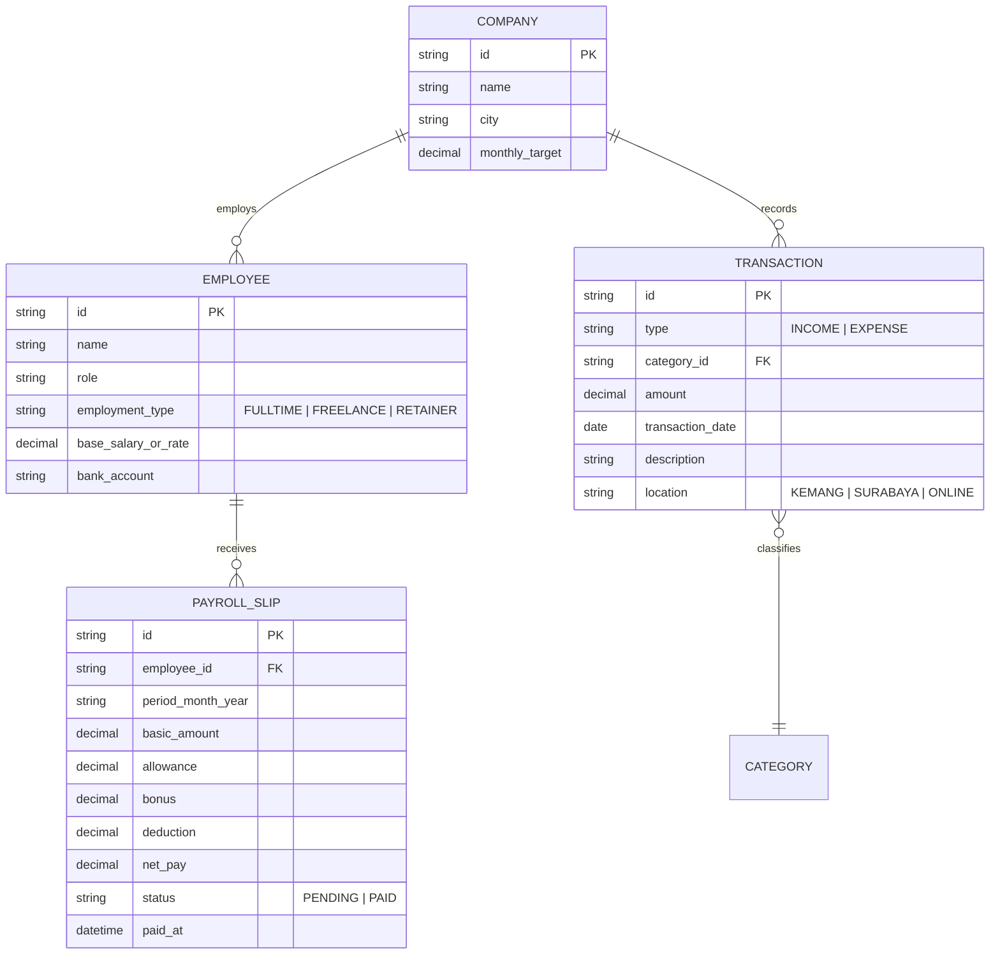

# Product Requirements Document (PRD)
## TabyFinance (PawRoll) — Cute Cat Financial & Payroll Companion

---

### Document Information
- **Project Name:** TabyFinance (PawRoll)
- **Target User / Client Profile:** Chansa Panggabean (Creative Agency Owner / Mompreneur)
- **Document Version:** v1.0 (MVP Prototype Scope)
- **Author:** Senior Software Engineer & Solutions Architect
- **Status:** Ready for Review & Implementation

---

## 1. Executive Summary & Problem Statement

### 1.1 Latar Belakang Klien
Klien (**@chansa_15**) menjalankan operasional bisnis berbasis jasa digital dan produksi konten yang melibatkan:
1. **Pekerja Tetap WFO:** Video Content Creator di studio Kemang, Jakarta Selatan (gaji Rp 5–7 jt/bulan).
2. **Pekerja Lepas / Freelancer:** Model Konten TikTok (per-project/sesi shooting) dan Media Buyer / Ads Specialist (retainer iklan Meta & TikTok).
3. **Kondisi Personal:** Seorang *working mom* dengan balita 2 tahun dan bayi *newborn* di Surabaya Barat yang menjalankan bisnis multi-kota (Surabaya ⇄ Kemang).

### 1.2 Masalah yang Dihadapi (Pain Points)
* **Spreadsheet Fatigue:** Menggunakan Google Sheets biasa terasa monoton, kaku, rentan salah rumus saat lelah, dan tidak memberikan kepuasan emosional.
* **Over-complicated Corporate Software:** Software akuntansi/ERP formal (seperti Mekari Jurnal atau Accurate) terlalu rumit, mahal, dan memiliki *learning curve* yang tinggi untuk skala studio kreatif 3–15 tim.
* **Beban Kognitif Tinggi:** Mengurus bayi sekaligus bisnis membuat klien membutuhkan antarmuka yang cepat dioperasikan (ringkas, minim input form) serta menyenangkan (*stress-reliever*).
* **Workforce Heterogen:** Penggajian tidak bisa disamaratakan karena ada karyawan gaji bulanan tetap, talent per-sesi, dan fee retainer agensi.

### 1.3 Solusi Produk
Sebuah **Aplikasi Web Finansial & Payroll Interaktif** dengan pendekatan **Gamified Pastel Dashboard & Cat Companion Engine** (mengadaptasi estetika viral *"Angy Taby"*). Aplikasi ini menggabungkan ketepatan kalkulasi finansial bisnis jasa dengan pengalaman pengguna yang ceria, menenangkan, dan memotivasi.

---

## 2. User Persona & User Journey

### 2.1 Persona Utama
* **Nama:** Chansa ("The Busy Creative Mompreneur")
* **Peran:** Business Owner, Creative Director, Finance & HR lead.
* **Karakteristik:** Cepat, visual-oriented, menghargai estetika manis (*cute & playful*), waktu terbatas di depan laptop.
* **Tujuan Utama:**
  1. Mengetahui apakah bulan ini profit atau tekor hanya dalam 5 detik.
  2. Membayar gaji tim tetap & honor talent freelance tanpa ribet hitung manual.
  3. Mengirimkan slip gaji estetik ke WhatsApp tim dengan 1 klik.

### 2.2 Core User Journeys

---

## 3. Product Scope & MoSCoW Prioritization

### 3.1 Must-Have (Cakupan Prototype MVP — Sprint 1)
1. **Interactive Cat Mood Engine:**
   * Maskot kucing interaktif yang ekspresinya berubah dinamis sesuai kondisi keuangan riil vs target (*Happy, Angy, Zen, Working*).
   * Balon percakapan (*speech bubble*) penyemangat dan validasi data.
2. **Hybrid Payroll Management:**
   * Master data karyawan/talent dengan 3 tipe kontrak: **Bulanan (WFO)**, **Per-Project/Sesi (Model)**, dan **Retainer (Ads Specialist)**.
   * Input komponen: Gaji Pokok, Tunjangan Kehadiran/Makan, Bonus/Lembur, dan Potongan Kasbon/Absensi.
   * Status pembayaran: *Pending* ⏳ vs *Paid* 🐾.
3. **Automated Cute Payslip Generator:**
   * Generate slip gaji estetik dengan maskot kucing dalam format siap cetak / PDF / preview digital.
4. **Service Cashflow Bookkeeping:**
   * Pencatatan Kas Masuk (DP Project, Pelunasan Jasa).
   * Pencatatan Kas Keluar dengan kategori spesifik agensi (Ad Spend, Talent Fee, Sewa/Petty Cash Studio Kemang, Tools Subscription).
   * Ringkasan Realita vs Target (Omset, Pengeluaran, Laba Bersih).
5. **Theme Pastel Grid UI ("Angy Taby" Style):**
   * Latar kertas grid hangat, palet lavender & soft yellow, tombol rounded, dan animasi mikro.

### 3.2 Should-Have (Fase 2)
1. **Pemisahan Dompet (Multi-Wallet):**
   * Pemisahan buku kas: *Kas Operasional Studio Kemang*, *Kas Utama Jasa*, dan *Petty Cash Domestik/Pribadi*.
2. **Export / Import Excel & CSV:**
   * Migrasi data dari template Google Sheets lama ke aplikasi web.
3. **Quick Share ke WhatsApp:**
   * Tombol *direct share* ringkasan gaji atau invoice langsung membuka tautan `wa.me` dengan template pesan otomatis.

### 3.3 Could-Have (Fase 3)
1. **Employee Self-Service (ESS View):**
   * Tautan unik khusus karyawan untuk melihat slip gaji mereka sendiri via browser smartphone tanpa bisa melihat data keuangan studio.

### 3.4 Out of Scope (Tidak Dikerjakan pada MVP)
* Akuntansi double-entry formal (Jurnal Debit/Kredit, Neraca Aktiva/Pasiva kompleks, Depresiasi Aset).
* Integrasi mesin absensi *fingerprint* / GPS tracker hardware.
* Integrasi otomatisasi e-Faktur pajak PPh 21 / PPN pemerintah.

---

## 4. Spesifikasi Fungsional Terperinci

### 4.1 Modul 1: The "Cat Mood Engine" (State-Driven Mascot)
Karakter kucing **Taby** bertindak sebagai *visual indicator* kesehatan bisnis:

| Status Keuangan | Ekspresi Kucing | Visual Asset | Pesan Balon Kucing |
| :--- | :--- | :--- | :--- |
| **Laba Bersih $\ge$ Target** | `Hapy` | Kucing mata berbinar + bandana hijau | *"Yay omset tercapai! Kerja keras tim terbayar lunas Kak Chansa! 🎉"* |
| **Laba Bersih Positif (Di bawah target)** | `Zen / Chill` | Kucing tersenyum santai | *"Arus kas aman terkendali. Pelan-pelan target pasti kekejar! ☕"* |
| **Laba Bersih Negatif / Minus** | `Angy` | Kucing cemberut lucu + pipi merah | *"Waduh tekor! Yuk rem pengeluaran atau genjot project baru! 😾"* |
| **Gajian Belum Selesai (H-3 Akhir Bulan)** | `Alert / Reminder` | Kucing pegang kalkulator | *"Ada 3 tim belum gajian lho! Jangan lupa ditransfer ya~ 🐾"* |

### 4.2 Modul 2: Hybrid Payroll & Kompensasi

#### Formula Perhitungan Gaji:
$$\text{Gaji Bersih (Take Home Pay)} = (\text{Gaji Pokok} + \text{Tunjangan} + \text{Bonus/Lembur}) - (\text{Kasbon} + \text{Potongan Lain})$$

#### Tipe Pekerja yang Didukung:
1. **Full-Time WFO (Contoh: Video Content Creator Kemang):**
   * Gaji Pokok Bulanan (misal Rp 6.000.000).
   * Tunjangan Uang Makan & Transport (misal Rp 500.000).
   * Potongan jika izin/absen.
2. **Freelance Talent (Contoh: Model Konten TikTok):**
   * Hitungan berbasis sesi shooting: $\text{Rate per Sesi} \times \text{Jumlah Sesi}$.
   * Bonus performa jika video FYP/tembus target views.
3. **Retainer Partner (Contoh: Media Buyer Ads Specialist):**
   * Biaya bulanan tetap (Fixed Retainer) + persentase bonus efisiensi ad spend.

#### Komponen Slip Gaji:
* Logo & Nama Studio (*Studio Kemang Creative*).
* Nomor Slip & Periode Gaji (Bulan/Tahun).
* Identitas Penerima (Nama, Jabatan, Nomor Rekening Bank).
* Rincian Penerimaan (Earnings) & Potongan (Deductions).
* Maskot Kucing dengan stempel lucu: *"Verified & Paid with Love 🐾"*.

### 4.3 Modul 3: Pembukuan Arus Kas (Service Bookkeeping)
* **Kategori Pemasukan (Incomes):**
  * Project Jasa Konten (DP / Termin 1).
  * Project Jasa Konten (Pelunasan).
  * Retainer Client Bulanan.
  * Pendapatan Adsense / Affiliate.
* **Kategori Pengeluaran (Expenses):**
  * *Payroll & Honor Talent* (terintegrasi otomatis dari modul payroll).
  * *Ad Spend / Saldo Iklan* (Top-up Meta Ads, TikTok Ads).
  * *Operasional Studio Kemang* (Sewa tempat, listrik, wifi, snack/katering shooting).
  * *Properti & Alat Shooting* (Wardrobe model, aksesoris, sewa lensa).
  * *Software & Tools* (Canva Pro, Adobe Creative Cloud, CapCut Pro, ChatGPT/AI).

---

## 5. UI/UX Design System Specification ("Angy Taby" Style)

### 5.1 Design Tokens (Color Palette)
* **Canvas Background:** `#FDFBF7` (Warm Cream) dengan pola background grid halus (`16px x 16px` border `#EAE5DC`).
* **Lilac Accent (Utama Payroll & Tabel):**
  * Soft Lavender: `#EDE9FE`
  * Lavender Border/Text: `#8B5CF6` / `#6D28D9`
* **Warm Butter Yellow (Highlight & Banner):**
  * Soft Butter: `#FEF3C7`
  * Deep Butter: `#F59E0B`
* **Status Badges:**
  * Success / Paid: Mint Sage `#D1FAE5` (Text: `#065F46`)
  * Pending / Due: Soft Blush Pink `#FEE2E2` (Text: `#991B1B`)
* **Neutral Text:**
  * Heading / Dark Text: `#2D2B38` (Soft Charcoal, hindari hitam pekat `#000000`)
  * Muted Caption: `#716D7D`

### 5.2 Tipografi
* **Display & Emotional Headings:** `Fredoka`, `Nunito`, atau `Shantell Sans` (Google Fonts, berkarakter bulat, ramah, dan santai).
* **Body & Financial Data:** `Plus Jakarta Sans` dengan fitur OpenType `tnum` (*tabular figures*) agar seluruh angka rupiah tersusun sejajar rapi.

### 5.3 Komponen Bentuk & Interaksi
* **Border Radius:** Sangat membulat (`rounded-2xl` = `16px`, `rounded-3xl` = `24px`).
* **Card Elevation:** *Playful soft drop-shadow* (`box-shadow: 0 4px 0 0 rgba(0,0,0,0.06), 0 8px 16px -4px rgba(0,0,0,0.04)`).
* **Micro-interactions:** Efek tombol memantul saat diklik (*active:scale-95*), konfeti warna-warni pastel saat tombol "Bayar Gaji" ditekan.

---

## 6. Arsitektur Data & Model Entitas

---

## 7. Rencana Pelaksanaan & Prototype Deliverables

1. **Sprint 1 (Current):**
   * Finalisasi PRD dan arsitektur desain (Dokumen ini).
   * Implementasi Web Prototype Interaktif berbasis React + Tailwind CSS di direktori `Client-Prototype-Web`.
   * Komponen Cat Mood interaktif, kalkulator penggajian tim Kemang & talent TikTok, serta dashboard ringkasan arus kas.
2. **Sprint 2:**
   * Fitur Generate PDF slip gaji estetik.
   * Filter pencatatan pengeluaran studio Kemang vs iklan ads.
   * Review dan demo bersama klien untuk mengunci *pricing & freelance contract value*.
